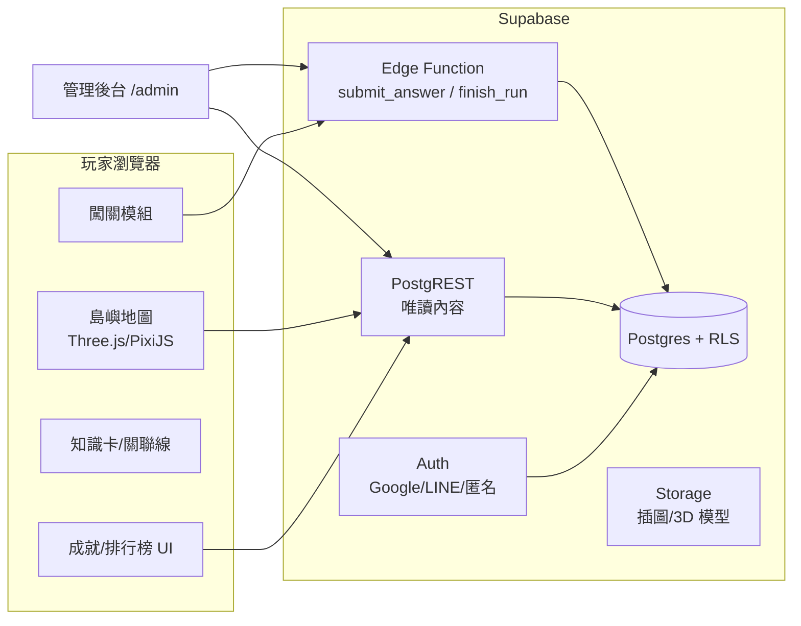

# 職安島：互動式職安衛學習遊戲網站架構

日期：2026-11-03 / 狀態：提案（尚未實作，技術選型待使用者拍板）
依據：使用者上傳的兩段螢幕錄影（各 83 秒，940×762），內容是 puma.taipei 的「HEART 政策島」與性格測驗。
本雲端 session 連不到 puma.taipei（網路政策擋掉，DNS 解析失敗），所以**以下觀察只來自影片畫面**。

---

## 1. 影片觀察：參考網站拆解

> 標示說明：【看到】是影片畫面上直接可見的；【推論】是從畫面推出來、還沒驗證的。

### 1.1 頁面與路由（【看到】網址列）

| 路由 | 角色 | 主要內容 |
|------|------|----------|
| `/heart-island` | 主遊戲：3D 島嶼地圖 | 16 座島 = 16 項政策，可拖曳、縮放、點選 |
| `/heart-island?focus=card` | 深連結 | 開啟時直接聚焦某張政策卡（可分享的狀態網址） |
| `/heart/quiz/1` | 互動測驗 | 7 題單選情境題，有進度條「第 1 題／共 7 題」 |
| `/heart/mom` | 測驗結果頁（人格類型） | 插畫、故事卡、表情回應、「來自魔法師的提醒」、政策推薦 |
| `/`（首頁） | 入口 | 宣傳影片、頁尾導覽（關於、政策願景、HEART 政策生態系…） |

### 1.2 島嶼地圖的互動元件（【看到】）

1. **新手導覽遮罩**：模糊背景上蓋一張卡片「HELLO, TAIPEI / 01 — 每塊島是一項政策，16 個等大六邊形…」，有「略過」按鈕。屬於分步驟引導。
2. **時段切換**：日出／白天／黃昏／夜晚，一共 4 顆按鈕，整座島的光影跟著改變（夜晚有路燈與光點）。
3. **工具列**：名牌（島名標籤開關）、搬運（小人物 NPC 動畫，頭上顯示「正在搬 水滴／資料夾」）、協作線（政策之間的連線）、暫停（停止動畫）、鳥瞰（切換視角），右側還有被裁掉的按鈕。
4. **島名標籤**：編號加名稱，例如「02 台北研究院」「14 語言」「16 AI」，點了會開政策卡。
5. **政策卡（POLICY 02・政見）**：標題、一句話摘要、引言、HEART 分類標籤（A／R／T／E，各有顏色）、「N 個細項／N 條協作」、細項清單（可點）。
6. **細項卡**：縮圖、所屬政策、標籤、對象（例如「申請服務的家庭」）、說明、重點條列；地圖上同時出現帶編號的標記（①②③）指向對應位置。
7. **協作線卡（CONNECTION・協作線 F1）**：標題、類型（候選人受訪）、社群數據（「15 位市民在這條線上」）、起點島到終點島的清單、F1…F29 的線索引，以及「資料來源」外部連結（點了會跳到自由時報新聞頁）。

### 1.3 測驗與結果頁（【看到】）

- 每題 4 個以上的生活情境選項，**沒有對錯**，用來分類玩家屬於哪一型（性格測驗）。
- 結果頁依類型（`/heart/mom`）呈現：主視覺插畫、故事卡（附 👍❤️🥹🙌😮 五種表情回應與累計數字 97）、角色留言、「魔法師的提醒」、對應這一型的政策推薦卡（標籤如「韌性與安心」「培力與機會」）。

### 1.4 技術面【推論】

- 低多邊形等角 3D 場景，加上即時光影與 NPC 動畫，**很可能**是 WebGL（Three.js 或 Babylon.js 一類），但未驗證。
- 「15 位市民在這條線上」和表情累計數字代表有**後端計數**（至少要能讀寫共享資料）。
- 政策、細項、協作線的結構高度一致，**很可能**由內容資料（JSON 或 CMS）驅動，不是寫死在頁面裡。

---

## 2. 對應到職安版：機制轉換表

| 參考網站機制 | 職安島的對應設計 | 教學目的 |
|-------------|----------------|----------|
| 16 座政策島 | 7 座職安主題島：法規港、管理塔、營造工地、化學工廠、變電所、健康診所、消防急救站 | 把考試範圍空間化，方便記憶 |
| 政策卡 + 細項 | **知識卡**：主題摘要、法條原文、重點條列、常考數字（例如 2 公尺、90 公分、8 小時通報） | 先讀後考 |
| 協作線 F1…F29 | **關聯線**：跨主題考點，例如「局限空間 ↔ 缺氧 18% ↔ 通風換氣 ↔ 監視人員」 | 建立知識網，對付整合型考題 |
| 搬運 NPC | **巡檢員 NPC**：在島上走動，頭上顯示「正在檢查 護欄」「發現 未接地」，點了觸發隨堂題 | 隨機複習 |
| 時段切換 | **班別**：白班、夜班（夜間作業、照明、過勞相關題目加權） | 情境化 |
| 島嶼外觀 | **職安指數**：答對、過關後，島上的危害物（傾倒的梯子、漏液桶）被清除，島變乾淨 | 進度看得見 |
| 性格測驗（無對錯） | 改成**考題闖關**（有對錯、附解說），另外保留一份「職安人格測驗」當入口吸引人 | 寓教於樂 |
| 結果頁人格類型 | **弱點診斷頁**：依錯題分布給「你是〇〇型安全員」，加上建議複習的島 | 個人化回饋 |
| 表情回應數字 | 成就徽章、積分排行榜、每週賽季 | 動機與社群 |
| `?focus=card` 深連結 | `?island=chem&card=ghs`：可以分享某張知識卡或某題 | 教學分享（例如老師貼給學生） |
| 新手導覽 | 3 步導覽：點島 → 讀卡 → 闖關 | 降低門檻 |

### 2.1 遊戲迴圈

```
進島 → 讀知識卡（可略過） → 巡檢闖關（每關 6 題，20 秒倒數）
  → 結算（星等、分數、新成就） → 島的外觀更新 → 錯題進錯題本 → 解鎖關聯線
```

- **計分**：答對 100 分，加上時間獎勵（0–50 分，依剩餘秒數），連擊 3 題 ×1.2、5 題 ×1.5；逾時算錯。
- **星等**：全對 3 星、≥67% 2 星、≥50% 1 星。排行榜採「各島最佳分數加總」，避免靠刷題灌分。
- **成就**（資料驅動，後台可增修）：登島報到、連續無災害（5 連擊）、零災害紀錄（單島全對）、眼明手快（5 秒內答對）、法規通（法規港 3 星）、全島巡檢、島主（全 3 星）、百題實戰、知錯能改（錯題本裡的題目複習時答對）、鍥而不捨（同一島挑戰 5 次）。

---

## 3. 系統架構

### 3.1 兩階段方案

| | 階段 A：MVP（零維運） | 階段 B：正式版（可大規模分享） |
|---|---|---|
| 前端 | 單一 HTML（SVG 等角島嶼，2D） | Vite + TypeScript；地圖用 Three.js（3D）或 PixiJS（2D 等角） |
| 託管 | claude.ai Artifact（Pro 帳號發布，分享連結） | Cloudflare Pages 或 GitHub Pages（免費、全球 CDN） |
| 資料 | Artifact 內建 `db`（共享文件庫） | Supabase：Postgres、Auth、列級權限（RLS）、Edge Functions |
| 排行榜寫入 | **組織外的訪客只能讀、不能寫**（見下方說明） | 任何登入玩家（Google／LINE 登入或匿名帳號）都能寫 |
| 後台 | 沒有（改題目要重新發布頁面） | 獨立的管理後台 `/admin` |
| 適合 | 先給自己和少數同事試玩、驗證題目與玩法 | 開放給全公司、學員、公眾 |

**階段 A 的關鍵限制（已查證平台文件）**：Artifact 的 `db` 能力只有 Contributor 以上的層級能寫入；從組織外透過公開連結進來的訪客屬於 `view` 層級，只能讀。個人 Pro 帳號底下，其他人幾乎都算「組織外」。所以公開分享之後，**大家可以玩，但成績寫不進共享排行榜**，只能存在各自的瀏覽器。要「大家都上排行榜」，就要走階段 B。

### 3.2 階段 B 模組圖



**防作弊的原則**：題目送到前端時**不附答案**。玩家作答後呼叫 `submit_answer`，由伺服器判定對錯、計時、算分，再回傳解說。排行榜只信任伺服器算出來的分數。

### 3.3 資料模型（Postgres）

| 資料表 | 主要欄位 | 說明 |
|--------|----------|------|
| `islands` | id, name, theme, sort, map_pos, unlock_rule | 島嶼與地圖座標 |
| `cards` | id, island_id, title, body_md, law_refs[], status | 知識卡 |
| `links` | id, code(F1…), from_card, to_card, note | 關聯線 |
| `questions` | id, island_id, stem, options jsonb, answer_idx, explanation, law_ref, law_effective_date, difficulty, status(draft/review/published/retired), version | 題庫（answer_idx 只給 Edge Function 讀） |
| `question_revisions` | question_id, version, diff, editor_id, created_at | 修訂歷史，可回溯 |
| `players` | id(auth uid), nickname, created_at, banned | 只存暱稱，不存真實姓名 |
| `runs` | id, player_id, island_id, mode(normal/review/daily), score, stars, started_at, finished_at | 一局 |
| `attempts` | run_id, question_id, chosen_idx, correct, elapsed_ms | 每題作答，用來做題目品質分析 |
| `achievements` | id, name, icon, rule jsonb, active | 成就定義（規則資料化，不寫死在程式） |
| `player_achievements` | player_id, achievement_id, unlocked_at | |
| `seasons` | id, name, starts_at, ends_at | 賽季，排行榜可以按季重置 |
| `reports` | id, question_id, player_id, reason, status | 玩家回報「題目有誤」 |
| `leaderboard` (materialized view) | season_id, player_id, total, stars, rank | 每 5 分鐘刷新 |

### 3.4 前端目錄結構

```
src/
  scenes/       island-map.ts（場景、相機、時段光照）、npc.ts（巡檢員）
  features/     quiz/、cards/、achievements/、leaderboard/、onboarding/
  data/         api.ts（Supabase client）、cache.ts（離線快取題庫）
  ui/           tokens.css（安全標誌色系）、components/
  routes.ts     /、/island/:id、/quiz/:runId、/result/:runId、/me、/admin/*
admin/          後台（同一 repo，登入後依角色顯示）
content/        初始題庫 CSV／JSON（版本控制，作為種子資料）
tests/          單元測試、題庫 schema 驗證、Playwright 冒煙測試
```

---

## 4. 後續管理與維護功能

### 4.1 管理後台（`/admin`，依角色授權）

| 功能 | 內容 | 角色 |
|------|------|------|
| 題庫 CMS | 新增、編輯、下架；支援 Markdown 與圖片；**Excel／CSV 批次匯入匯出**（老師最常用） | 出題者 |
| 審核流程 | 草稿 → 待審 → 上架；上架前必須填法源與解說；審核者和出題者不能是同一人 | 審核者 |
| 法規異動追蹤 | 每題綁 `law_ref` 和生效日；法規修正時，在後台輸入條號，系統列出所有受影響的題目，標記「待複核」並暫時下架 | 審核者 |
| 題目品質分析 | 每題答對率、平均作答秒數、鑑別度（高分組和低分組答對率的差）、各選項被選比例；自動標記「太簡單（>95%）」「太難（<20%）」「誘答失效（某選項沒人選）」 | 出題者 |
| 玩家回報處理 | 回報清單 → 修題 → 回覆 → 結案 | 出題者 |
| 知識卡與關聯線編輯 | 拖拉式編輯關聯線（F 編號自動產生） | 出題者 |
| 成就與賽季設定 | 用規則 JSON 新增成就（例如 `{"type":"streak","n":10}`）；設定賽季起訖與獎勵 | 管理員 |
| 玩家與排行榜管理 | 暱稱過濾（敏感詞）、停權、移除異常成績；異常偵測：每題 <1 秒且全對、短時間大量重玩 | 管理員 |
| 公告與活動 | 首頁公告、限時活動島（例如「職安週特別關卡」） | 管理員 |
| 數據儀表板 | 每日活躍人數、新玩家數、各島通過率、全體弱項排行（給教學單位調整課程用） | 管理員、主管 |

### 4.2 維運

| 項目 | 做法 |
|------|------|
| CI | GitHub Actions：lint、型別檢查、單元測試、**題庫 schema 驗證**（每題 4 個選項不重複、答案索引合法、解說與法源都有填）、Playwright 冒煙測試（進島 → 答一題 → 結算） |
| 部署 | 每個 PR 自動產生預覽網址；合併進 main 後自動上線；可一鍵回到上一版 |
| 備份 | Supabase 每日自動備份，另外每週用 GitHub Actions 跑 `pg_dump`，存到私有儲存空間；題庫另有一份 CSV 匯出放 repo |
| 監控 | 前端錯誤用 Sentry；服務存活用 UptimeRobot；Edge Function 的錯誤率與延遲告警 |
| 效能 | 3D 模型做成 glTF 加 Draco 壓縮；偵測低階手機時自動切換 2D 地圖；題庫快取在 IndexedDB，弱網路也能玩 |
| 安全 | RLS 預設全部拒絕；答案欄位只有 service role 能讀；Edge Function 依玩家做流量限制 |
| 個資 | 只收暱稱與登入識別碼；提供「刪除我的資料」；放隱私權聲明（個資法） |
| 無障礙 | 選項可用鍵盤 1–4 作答；配色符合 WCAG AA；尊重 `prefers-reduced-motion`（關閉 NPC 動畫） |
| 依賴更新 | Dependabot 每週開 PR，CI 綠燈才合併 |

---

## 5. 開發路線

| 階段 | 交付物 | 驗收方式 |
|------|--------|----------|
| 0 | 題庫第一版：7 島 × 8 題，附解說與法源，經人工審核 | 題庫 schema 驗證通過；至少一位持證人員複核 |
| 1（MVP） | 單一 HTML 的 2D 島嶼、闖關、成就、錯題本、Artifact 排行榜 | 自己和同事實際玩完一輪，排行榜讀寫正常 |
| 2 | 正式版：Supabase 後端、伺服器端計分、登入、排行榜、賽季 | 外部帳號能登上排行榜；作弊測試（改前端）無效 |
| 3 | 管理後台：題庫 CMS、匯入匯出、審核流程、品質分析 | 出題者不靠工程師就能上架一題 |
| 4 | 3D 島嶼、NPC、時段光照、關聯線、職安人格測驗 | 低階手機能流暢遊玩（≥30 fps 或自動降級為 2D） |

---

## 6. 待確認事項

1. **目標對象**：考證照的學員（乙級、甲級）、公司內部員工訓練，還是一般大眾？這會決定題目難度與登入方式。
2. **題目來源與版權**：技能檢定的公告試題可以引用，但補習班或教材上的題目不能直接搬。
3. **題目正確性**：法規會修正，每題上架前都要有持證人員複核。這份文件裡的題例是 AI 依現行法規整理的，**沒有逐條對照全國法規資料庫**。
4. **技術棧**：本文件建議 Supabase；如果公司已經在用 Firebase 或 Azure，可以換成對應的服務，資料模型不用變。
5. **puma.taipei 的實際技術**：受網路限制沒能直接讀取網站，第 1.4 節都是推論。
